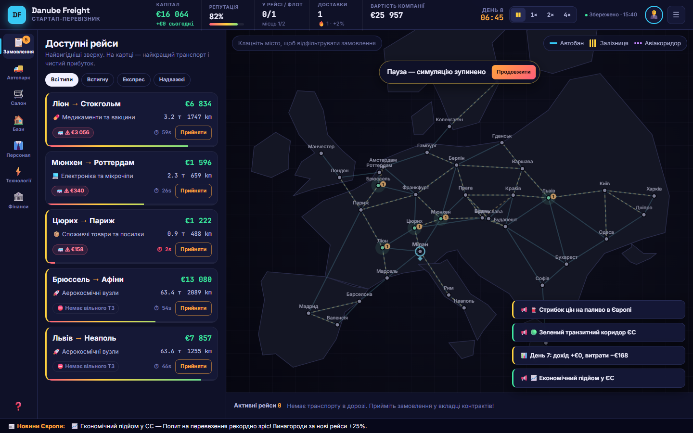
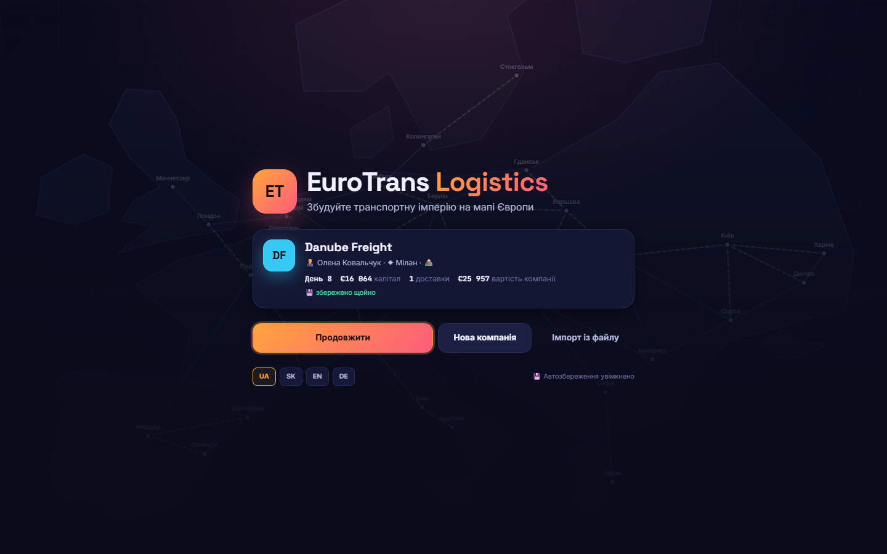
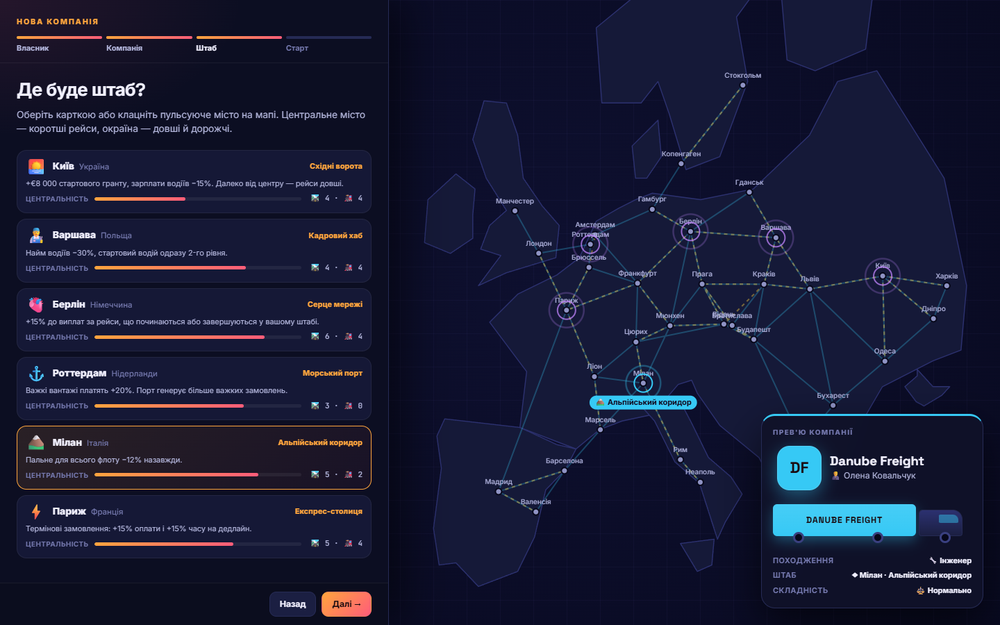
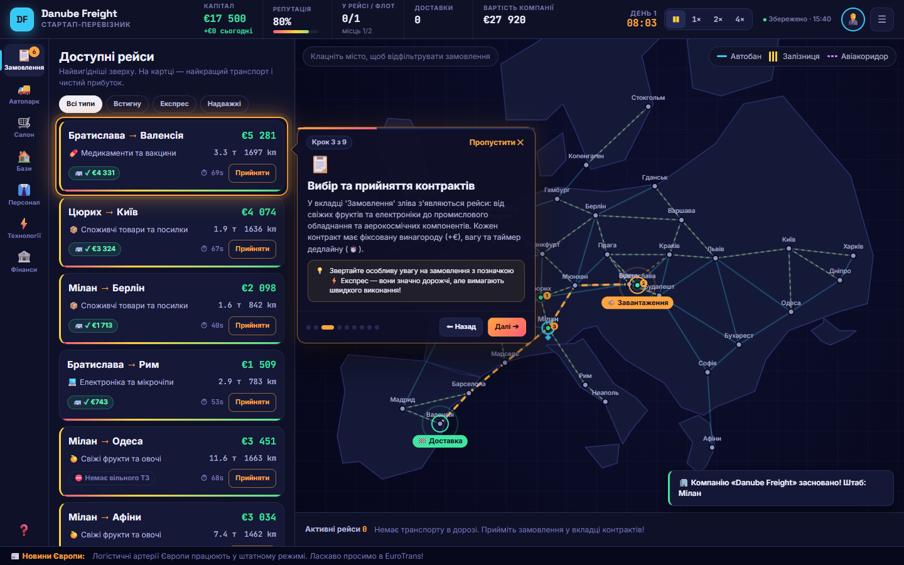
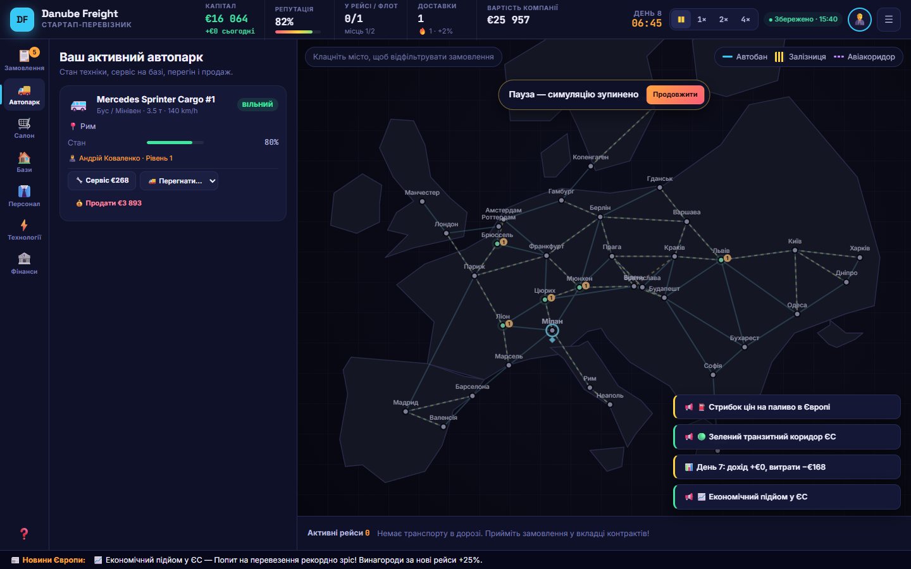
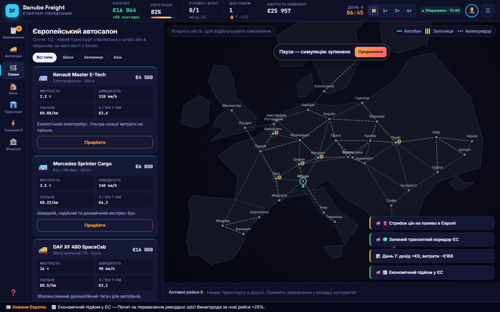
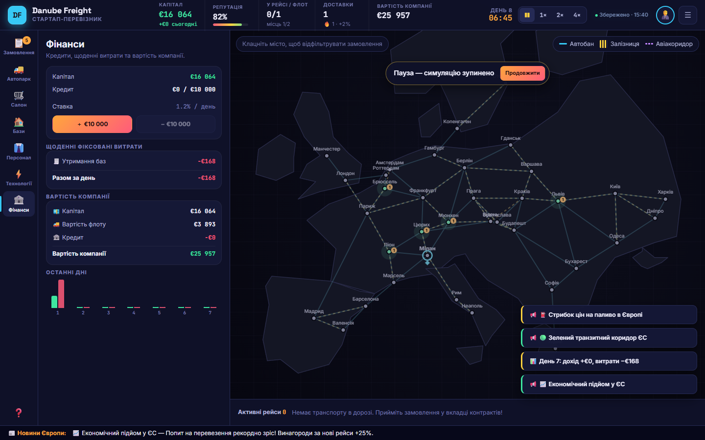
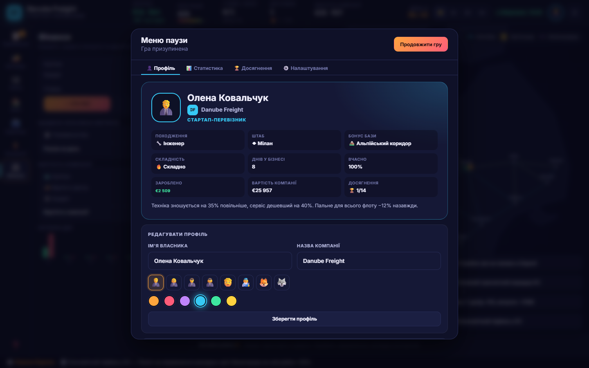
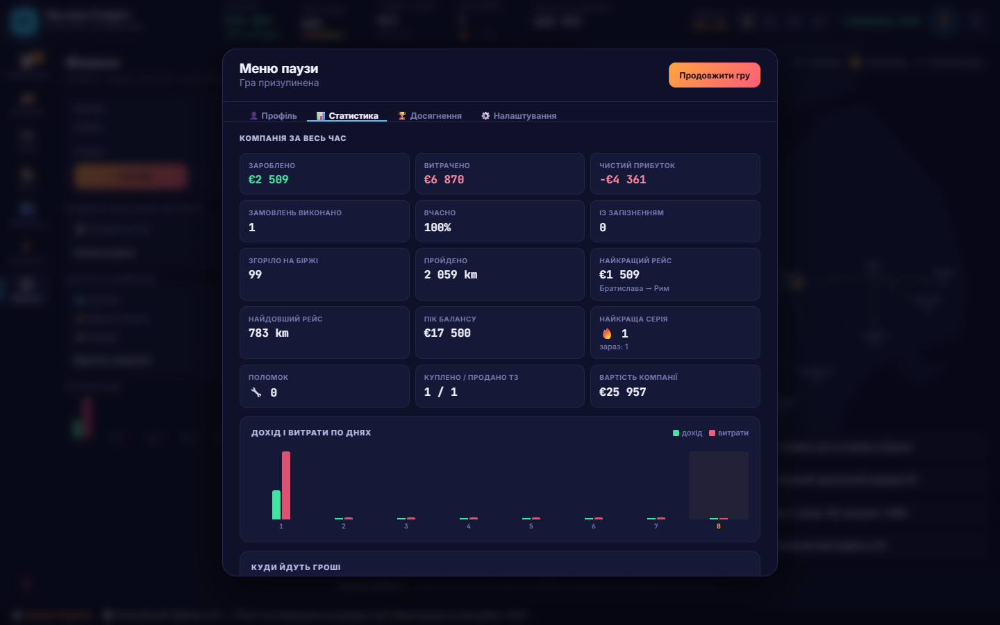
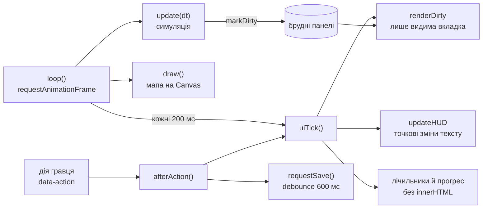

<div align="center">

# EuroTrans Logistics

**Браузерна економічна стратегія: збудуйте транспортну імперію на мапі Європи.**

Засновуйте компанію, обирайте штаб, беріть вигідні замовлення, доглядайте за технікою, керуйте кредитами — і не збанкрутуйте.



`36 міст` · `12 моделей техніки` · `автотраси, залізниця, авіа` · `4 мови` · `автозбереження` · `без встановлення`

</div>

---

## Запуск

Відкрийте **`index.html`** у Chrome, Edge або Firefox. Збирати нічого не треба: гра працює локально, інтернет потрібен лише для шрифтів (без нього підставляться системні).

Прогрес зберігається автоматично. Після перезавантаження сторінки натисніть **«Продовжити»**.

---

## Як почати

<table>
<tr>
<td width="50%"></td>
<td width="50%"></td>
</tr>
<tr>
<td><b>Титульний екран.</b> Картка збереженої компанії з днем, капіталом і вартістю. Тут же архів попередніх компаній і вибір мови.</td>
<td><b>Майстер заснування на 4 кроки:</b> власник → компанія → штаб → складність. Справа видно живе прев'ю з вантажівкою у фірмовому кольорі.</td>
</tr>
</table>

Кожен вибір у майстрі впливає на гру.

**Походження власника** дає постійний бонус:

| | Походження | Бонус |
|---|---|---|
| 🚚 | Колишній далекобійник | Водії +30% досвіду, стартовий водій на рівень вищий |
| 📊 | Фінансист | +€5 000, кредит 0.6%/день замість 1.2%, ліміт +50% |
| 🔧 | Інженер | Знос −35%, сервіс −40% |
| 🤝 | Переговорник | +6% до оплати всіх замовлень, репутація росте швидше |

**Штаб** визначає стиль гри. Для кожного міста видно центральність і кількість доріг і залізниць:

| Штаб | Бонус |
|---|---|
| 🌅 Київ | +€8 000, зарплати −15%. Далеко від центру — довгі, дорогі рейси |
| 🧑‍🔧 Варшава | Найм −30%, стартовий водій 2-го рівня |
| 🫀 Берлін | +15% за рейси зі штабу або до нього |
| ⚓ Роттердам | Важкі вантажі +20%, більше важких замовлень |
| 🏔️ Мілан | Пальне −12% для всього флоту |
| ⚡ Париж | Термінові замовлення +15% оплати і +15% часу |

**Складність:**

| | Капітал | Оплата | Утримання | Дедлайни | Знос | Банкрутство через |
|---|---|---|---|---|---|---|
| 🌱 Легко | ×1.4 | ×1.1 | ×0.6 | ×1.25 | ×0.7 | 5 днів у мінусі |
| ⚖️ Нормально | ×1 | ×1 | ×1 | ×1 | ×1 | 3 дні |
| 🔥 Складно | ×0.7 | ×0.85 | ×1.4 | ×0.85 | ×1.35 | 2 дні |

Після заснування запускається **туторіал без затемнення екрана**. Картка-підказка стоїть поруч із тим, про що йдеться, а на мапі підсвічуються штаб, маршрут замовлення, бази й транспорт. Окремий крок пояснює стан техніки і ремонт.



---

## Ігрові механіки

### Замовлення
Біржа сама сортує замовлення від найвигідніших. На кожній картці видно найкращий вільний транспорт, **чистий прибуток** (виплата − пальне − зарплата) і чи він **встигне** до дедлайну. Смужка внизу картки — час, що залишився.

Вікно призначення показує прогноз для кожного ТЗ: час прибуття, пальне, зарплату й підсумок. Транспорт без водія, без потрібної кваліфікації, місткості чи маршруту призначити не можна, і причина пишеться поруч.

### Гроші й ризик
- **Операційні витрати можуть загнати баланс у мінус:** пальне, зарплати (ставка + €0.15/км), щоденне утримання баз, відсотки, абонплати.
- Якщо баланс у мінусі кілька днів поспіль, настає **банкрутство**. Компанія йде в архів, а кар'єра власника зберігається.
- **Кредит** (вкладка «Фінанси») береться кроками по €10 000. Ліміт росте разом із заробленим.
- **Вартість компанії** (гроші + техніка + бази − борг) — головний показник успіху.

### Техніка
- **Знос** за кожен кілометр: дорога зношує найсильніше, залізниця найменше. Нижче 40% ТЗ повільнішає, нижче 25% може **зламатися** в дорозі (простій і ремонт).
- **Сервіс** на власній базі коштує вдвічі менше, ніж у дорозі.
- **Перегін** порожнього ТЗ на іншу свою базу.
- **Продаж** за ціною, що залежить від стану.

### Розвиток
- **Бази** (3 рівні): більше машиномісць і бонус до виплат з міста, але щоденне утримання.
- **Персонал:** на біржі праці завжди щонайменше 10 кандидатів: по 2 на фургони, потяги й літаки, 3 на тягачі та універсал. Щодня частина кандидатів змінюється, є фільтр за кваліфікацією і позначка, хто підходить до вашої машини без водія. Водії ростуть у рівнях і стають швидшими та економнішими, але дорожчими.
- **Технології:** постійні апгрейди та «компроміси» з плюсом і мінусом, які можна вмикати й вимикати.
- **Репутація** множить ціни нових замовлень (від ×0.88 до ×1.15), а VIP-замовлення відкриваються лише від 70%.
- **Серія** вчасних доставок дає до +20% до виплат.
- **Події** (паливна криза, снігопад, зелений коридор, економічний підйом) діють 40 секунд.
- **14 досягнень** з грошовими нагородами.

<table>
<tr>
<td width="33%"></td>
<td width="33%"></td>
<td width="33%"></td>
</tr>
<tr><td align="center">Автопарк</td><td align="center">Автосалон</td><td align="center">Фінанси</td></tr>
</table>

### Профіль власника і статистика
Кнопка з аватаром або `Esc` відкривають меню з чотирма вкладками:

- **Профіль:** ім'я, аватар, фірмовий колір (усе можна змінити), штаб, бонуси, архів попередніх компаній.
- **Статистика за весь час:** зароблено/витрачено/прибуток, вчасно/із запізненням, кілометри, рекорди, поломки, графік по днях, структура витрат і кар'єра власника через усі компанії.
- **Досягнення.**
- **Налаштування:** мова, звук, збереження (зберегти зараз, експорт і імпорт файлу), туторіал, нова компанія.

<table>
<tr>
<td width="50%"></td>
<td width="50%"></td>
</tr>
</table>

---

## Керування

| Дія | Клавіша |
|---|---|
| Пауза / продовжити | `Пробіл` |
| Швидкість 1× / 2× / 4× | `1` / `2` / `3` |
| Вкладки: замовлення, автопарк, салон, бази, персонал, технології, фінанси | `Q` `W` `E` `R` `T` `Y` `U` |
| Меню паузи · закрити вікно · крок назад у майстрі | `Esc` |
| Продовжити гру з титульного екрана | `Enter` |
| Фільтр замовлень за містом | клік по місту на мапі |

---

## Збереження

| Що | Де (`localStorage`) | Коли |
|---|---|---|
| Поточна компанія | `eurotrans_save` | кожні 10 с, після кожної дії, при закритті або згортанні вкладки |
| Налаштування (мова, звук, туторіал, вкладка) | `eurotrans_settings` | одразу при зміні |
| Кар'єра власника | `eurotrans_career` | після кожної доставки |
| Архів закритих компаній (до 8) | `eurotrans_archive` | при заснуванні нової компанії |

- Час останнього збереження видно у верхній панелі (`● Збережено · 15:40`).
- Збереження має **версію** (`SAVE_VERSION = 4`). Сейви попередньої версії гри автоматично мігрують.
- **Експорт і імпорт** у `.json`-файл (меню → Налаштування або титульний екран) дозволяє перенести гру на інший комп'ютер чи браузер.
- Пошкоджений або чужий файл не ламає гру: він просто не завантажиться.

---

## Архітектура

Звичайні `<script>`-файли без збирача. ES-модулі не працюють через `file://`, а гра має відкриватися подвійним кліком. Клас `EuroLogisticsGame` містить лише ядро, а решта поведінки підмішується тематичними модулями.

```
index.html
css/
  tokens.css        дизайн-токени: кольори, шрифти, відступи
  layout.css        каркас: верхня панель, рейка, панель, мапа
  components.css    кнопки, картки, форми, модалки, тости
  screens.css       титулка, майстер, меню паузи, туторіал
js/
  data/             статичні дані: міста й дороги, каталог, бази, складності, переклади
  core/             GameState і міграція, звук, головний цикл
  systems/          логіка без DOM: маршрути, економіка, замовлення, флот, компанія, збереження
  render/map.js     Canvas-мапа
  ui/               панелі, майстер, меню паузи, туторіал, обробники подій, i18n
  main.js           точка входу
tests/
  unit/             node:test — маршрути, економіка, збереження, повнота перекладів
  e2e/smoke.js      наскрізний сценарій у справжньому Chrome
```



Ключові рішення:
- **Чисті модулі для логіки.** `Routing`, `Economy` і `SaveStore` не торкаються DOM, тому покриті юніт-тестами.
- **Делегування подій.** Кнопки в списках мають `data-action` і `data-id`. Один слухач замість inline `onclick` і глобального `window.game`.
- **Локалізація розміткою.** `data-i18n`, `data-i18n-title`, `data-i18n-ph` замість ручних `querySelector` для кожного тексту.

### Продуктивність

Виміряно бенчмарком: 8 ТЗ у рейсах, 300 кадрів, headless Chrome.

| | До | Після |
|---|---|---|
| Скрипт на кадр | 1.70 мс | **0.54 мс** (×3.1) |
| DOM-мутацій на кадр | 13.2 | **3** |

Що дало результат:
- UI оновлюється 5 разів на секунду замість 60, і лише «брудні» панелі, а HUD — точковими змінами тексту.
- Статичний шар мапи (суходіл, сітка, дороги) малюється один раз в offscreen-canvas.
- Шляхи (Дейкстра) кешуються, бо мережа статична.
- Розмір мапи відстежує `ResizeObserver` замість читання layout у кожному кадрі.
- Canvas масштабується під `devicePixelRatio`, тож на HiDPI мапа чітка.

---

## Тести

```bash
npm test               # 46 юніт-тестів, без залежностей (Node 20+)

npm install            # puppeteer-core для e2e
npm run test:e2e       # наскрізний сценарій у Chrome (шлях — змінна CHROME_PATH)
npm run screenshots    # той самий сценарій + скріншоти в docs/screenshots
```

Юніт-тести перевіряють:
- маршрутизацію (досяжність усіх міст, коректні ребра, кеш);
- формули економіки (виплати, штрафи, страховка, знос, сервіс, кредити, вартість компанії);
- біржу праці (склад за кваліфікаціями, унікальні імена, щоденна ротація, доповнення старих збережень);
- збереження (round-trip, міграція v3, пошкоджені дані, недоступне сховище, експорт/імпорт, архів);
- повноту перекладів (кожен використаний ключ є в усіх 4 мовах, плейсхолдери збігаються).

E2E проходить увесь шлях гравця: майстер з валідацією → туторіал → рейс → кредит, купівля, сервіс, продаж → кілька ігрових днів → перезавантаження зі збереженням → банкрутство → архів. Крім того, тест перевіряє, що в консолі немає помилок.

---

## Мови

🇺🇦 Українська · 🇸🇰 Slovenčina · 🇬🇧 English · 🇩🇪 Deutsch. Перемикаються на титульному екрані або в налаштуваннях.
